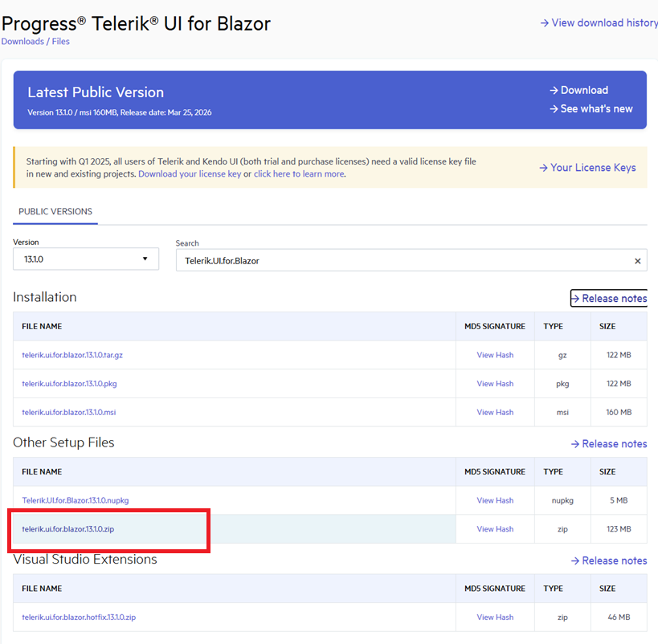
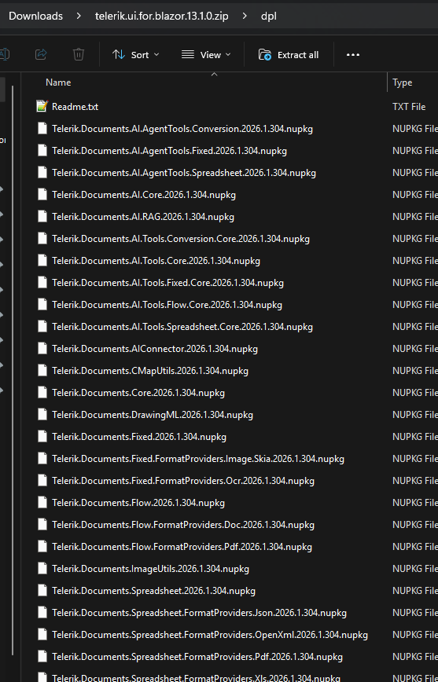
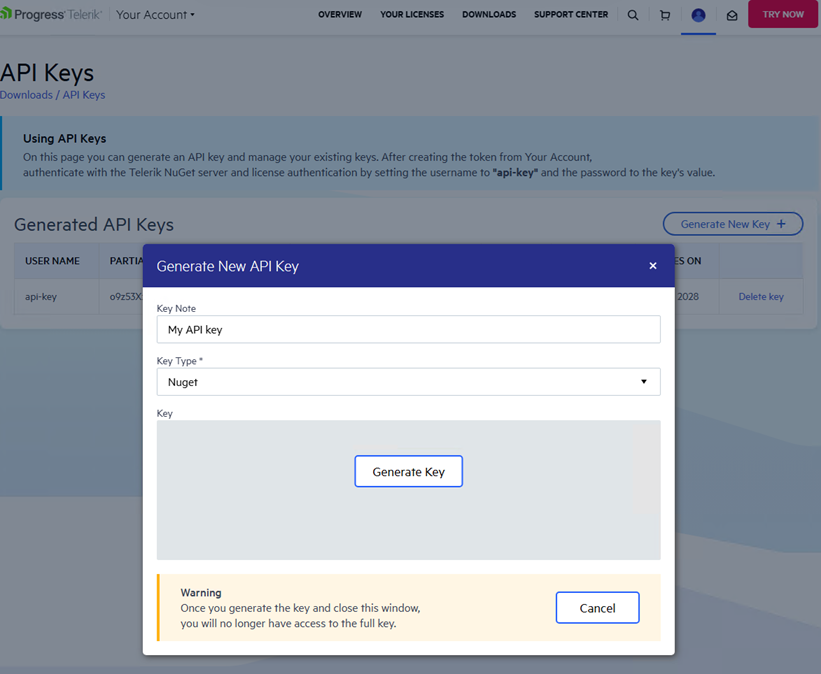
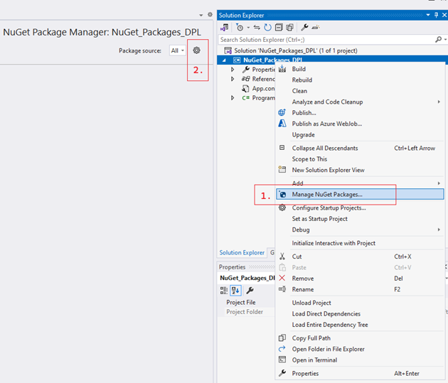
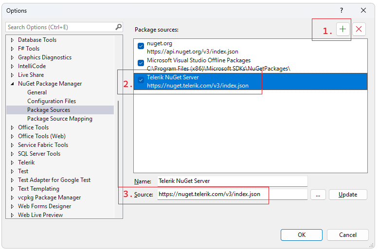

# Resolving Telerik UI for Blazor NuGet Restore Failures Due to Missing Dependencies

## Environment

The issue applies to the following product versions:

| Version | Product |
| ---- | ---- |
| 2026.1.210 | Telerik Document Processing |
| 13.1.0 (Trial) | Telerik.UI.for.Blazor |

Author: [Desislava Yordanova](https://www.telerik.com/blogs/author/desislava-yordanova).

## Description

With an active Blazor trial license, a restore of the `Telerik.UI.for.Blazor` package may fail because Telerik Document Processing dependencies are missing. Examples include `Telerik.Documents.Spreadsheet`, `Telerik.Documents.SpreadsheetStreaming`, and `Telerik.Zip`.

## Solution

Activate a [trial for DevCraft](https://www.telerik.com/download). This enables the Document Processing Downloads section in your Telerik account.

Alternatively, instead of using the NuGet packages, download the zip (for example, `telerik.ui.for.blazor.13.1.0.zip`) from your Telerik account:



The ZIP archive contains all necessary Telerik Document Processing assemblies:



To ensure that the Telerik NuGet server is set up correctly on your machine, follow the steps:

1. Generate a new NuGet application programming interface (API) key from your Telerik account. Use this key instead of a password to authenticate with the trial account:

    

2. Configure the Telerik NuGet server as a package source in Visual Studio:

    

3. Delete any existing package sources that contain Telerik NuGet packages. Add a new package source and enter `https://nuget.telerik.com/v3/index.json` in the **Source** field:

    

4. Specify the credentials in the NuGet configuration file. Replace `Your API KEY` in the following example with your generated API key:
   ```xml
   <?xml version="1.0" encoding="utf-8"?>
   <configuration>
       <packageSources>
           <clear />
           <add key="nuget.org" value="https://api.nuget.org/v3/index.json" />
           <add key="TelerikNuGetServer" value="https://nuget.telerik.com/v3/index.json" />
       </packageSources>
       <packageSourceCredentials>
           <TelerikNuGetServer>
               <add key="Username" value="api-key" />
               <add key="ClearTextPassword" value="Your API KEY" />
           </TelerikNuGetServer>
       </packageSourceCredentials>
   </configuration>
   ```

This ensures that you have added the Telerik NuGet feed as a package source associated with your trial license.

>note If you previously stored credentials for the Telerik NuGet server, reset them to authenticate with your new API key. Remove the saved credentials in the [Windows Credential Manager](https://support.microsoft.com/en-us/windows/credential-manager-in-windows-1b5c916a-6a16-889f-8581-fc16e8165ac0). These credentials appear as `nuget.telerik.com` or `VSCredentials_nuget.telerik.com` entries.

## See Also

* [Troubleshooting Telerik NuGet Feed](https://www.telerik.com/blazor-ui/documentation/troubleshooting/nuget-feed#unable-to-find-package)
