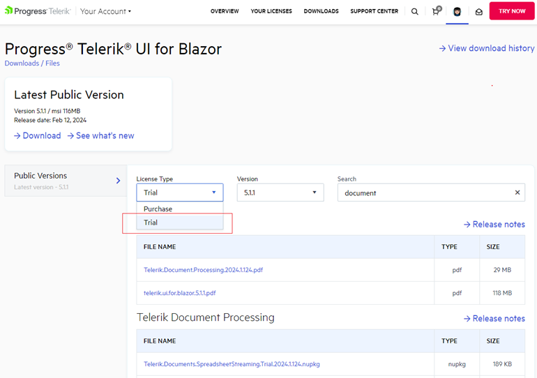
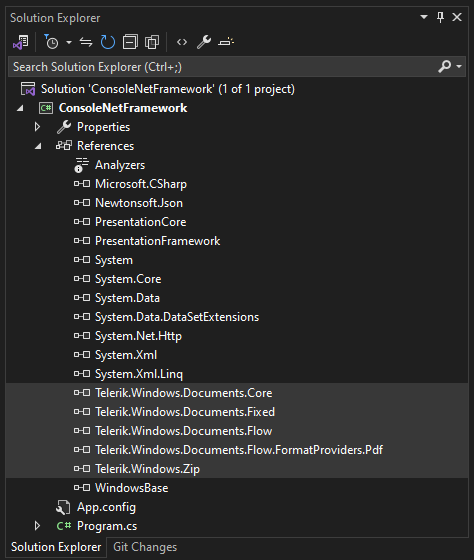
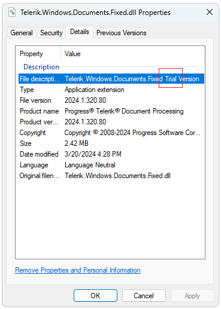
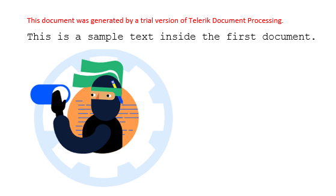
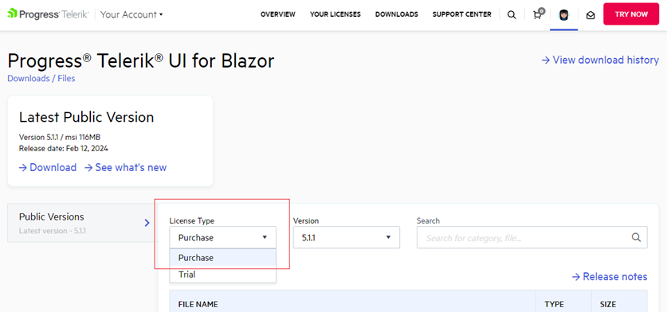
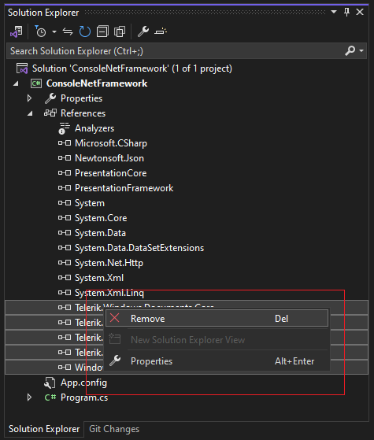
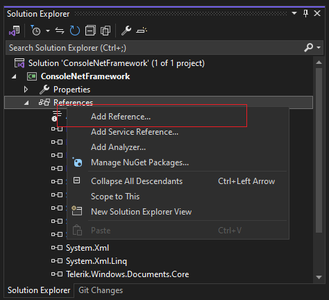
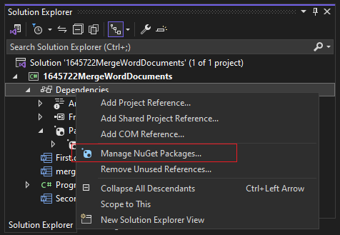
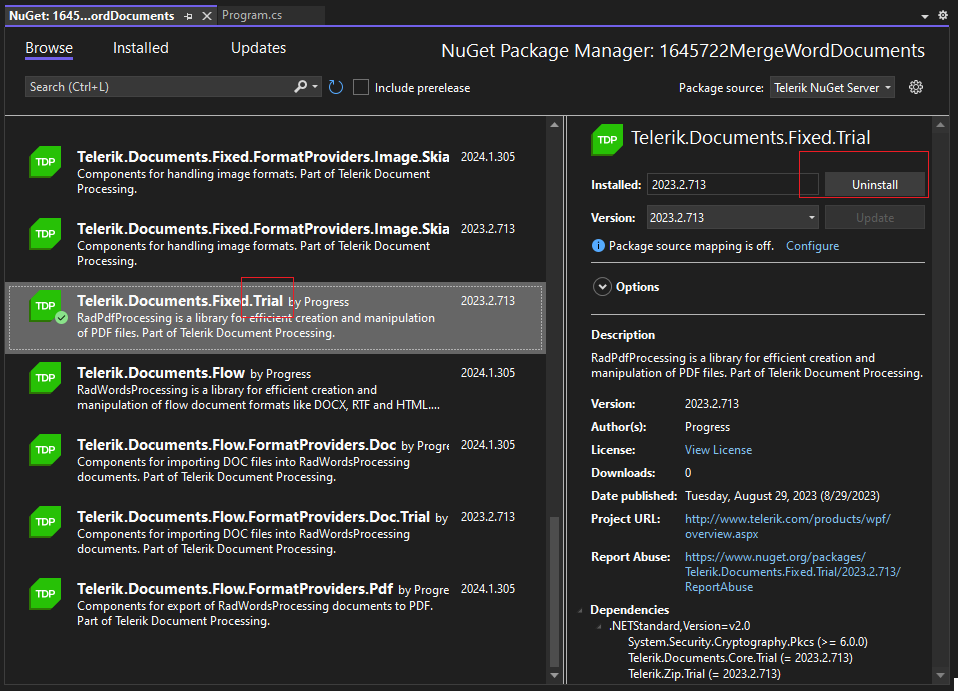
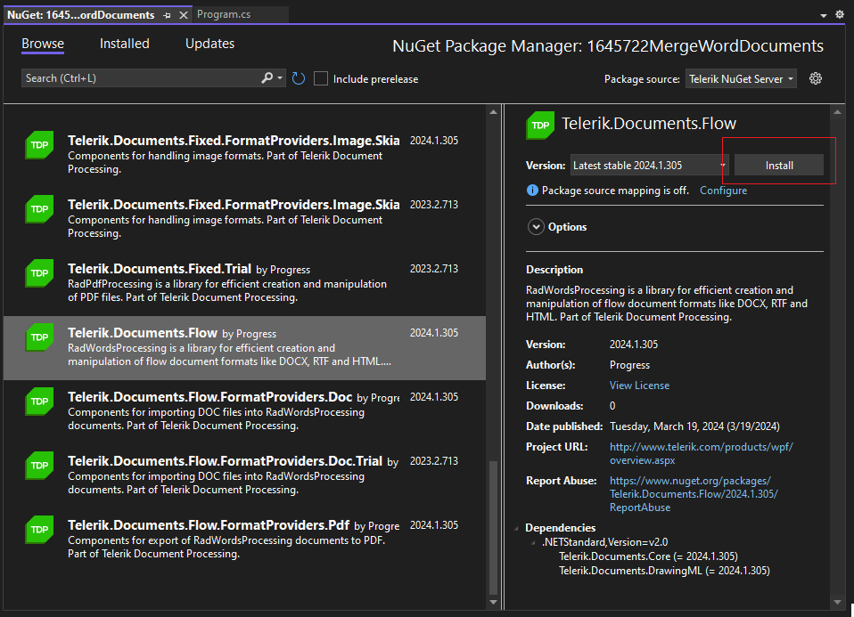

Replace trial assemblies or NuGet packages with licensed versions for releases before Q2 2025.

| Version | Product | Author | 
| --- | --- | ---- | 
| Valid until Q2 2025 | Document Processing Libraries |[Desislava Yordanova](https://www.telerik.com/blogs/author/desislava-yordanova)| 

## Description

This tutorial explains in detail how to upgrade your Telerik [Trial]() to a Licensed version of the Document Processing Libraries.

>caution This approach is valid for versions **before Q2 2025**. For later versions, update the [license key]().

Start with a trial version installed on your machine and a project that references the trial version:

>caption Access to the Trial version of product files in the Downloads section of your Telerik account

>note Telerik Document Processing is a part of several Telerik bundles and is installed following the steps for installing the suite with which you have obtained the product: [Installing on Your Computer]()

If you expand the **References** in the Solution Explorer in Visual Studio, you will see the currently referred assemblies in the project:

>caption Trial Assemblies referred in the project 

Navigate to the project's folder and right-click the `.dll` to open the Properties dialog box to check if the **Trial** `.dll` is added.

>note The only difference between the license and trial versions of the assemblies is that trial assemblies add a copyright message to the produced documents:

## Solution

Once you purchase a Telerik license, you will have access to the *Purchase* **License Type** in your Telerik account:

Depending on the Telerik product with which you have obtained the Telerik Document Processing, the libraries can be used either through the [available NuGet packages]() or through the assemblies available in the installation folder of the Telerik product.

## Upgrade the Trial Assemblies

1. **Download** the `.msi` file for the *Purchase* version.

2. **Uninstall** the already installed *Trial* version, for example, from **Control Panel** > **Programs and Features**.

3. **Install** the downloaded `.msi` file in step 1.

4. Update the references in your project with the assemblies from the licensed installation. Delete the old trial assemblies first and then add the licensed ones:

    

    

5. **Delete** the `license.licx` file (if such file exists).

6. **Rebuild** your project, close Visual Studio, and open it again to ensure that no references are kept in the memory by Visual Studio.

## Upgrade the Trial NuGet Packages

1. Open the **NuGet Package Manager**, for example, select the **Manage NuGet Packages...** option.

    

2. Uninstall any **Trial** Telerik NuGet packages:

    

3. Install the respective **Purchase** version of the NuGet packages, without the word "Trial" in its name:

    

## See Also

* [Trial vs Licensed version]() 
* [Installing on Your Computer]()
* [Install using NuGet Packages]()
