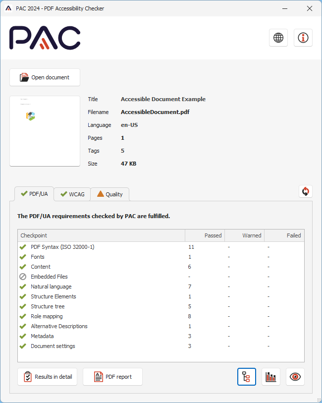
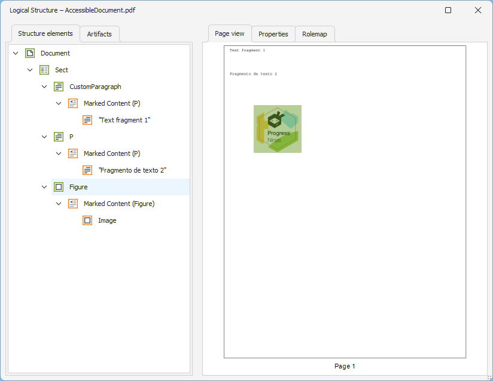
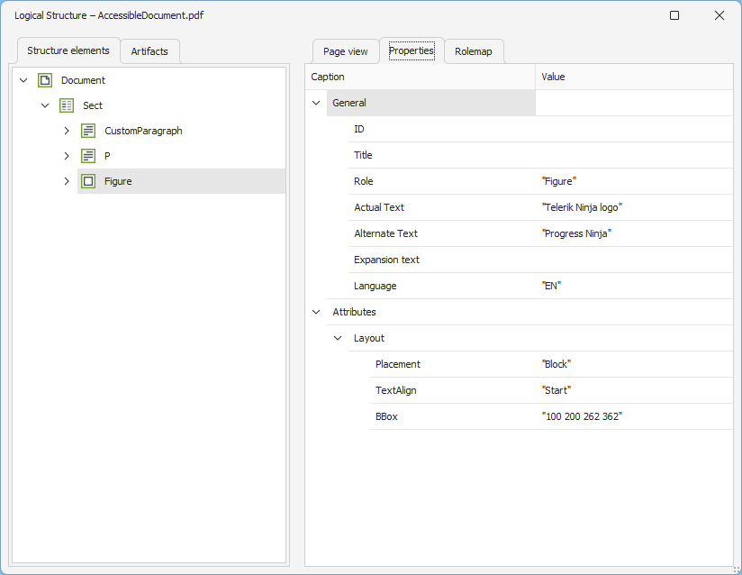

# Creating Accessible PDF Documents 

Use `RadPdfProcessing` of Telerik Document Processing to generate accessible PDF documents. This article shows how to export accessible output by using compliance settings, tagging strategies, and structure trees.

Feature availability and related documentation:

* Minimum version: Q3 2025
* Related feature: [Accessibility Support]()

To export accessible output, the document must target **PDF/A-1a**, **PDF/A-2a**, **PDF/A-3a**, or **PDF/UA-1** compliance. To achieve this, configure `PdfFormatProvider.ExportSettings.ComplianceLevel` and `PdfFormatProvider.ExportSettings.TaggingStrategy` as described in [PdfComplianceLevel](#accessibility-compliance) and [Tagged PDF]().

`RadFixedDocument` provides a constructor overload with an `autoTag` parameter. The `AutoTag` property is `false` by default. You can either build the `StructureTree` yourself or let the library tag elements automatically.

>note Refer to the [PdfProcessing Accessibility Demo](https://demos.telerik.com/document-processing/pdfprocessing/accessibility). It shows how to create accessible PDF documents programmatically and export files that match the selected compliance level.

>important In **.NET Standard/.NET (Target OS: None)** environments, fonts beyond the [14 standard ones](#standard-fonts) require a [FontsProvider implementation]() to be resolved correctly.

## Creating Accessible PDF Documents with an Existing Structure Tree

When you already have a `StructureTree`, export the document with [`TaggingStrategyType.UseExisting`](#tagging-strategy) so the existing structure is preserved:

<snippet id='libraries-pdf-features-accessible-pdf'/>

The following screenshots show the validation and structure views for the generated PDF.

**PDF Accessibility Checker validation**

**Logical structure**

**Logical structure properties**

## Creating Accessible PDF Documents with Auto-Tagging

The following example adds content to a PDF document and lets `RadPdfProcessing` build the `StructureTree` automatically by using `TaggingStrategyType.Build`:

<snippet id='libraries-pdf-features-accessible-pdf-with-auto-tagging'/>

## See Also

* [RadPdfProcessing]()
* [Tagged PDF]()
* [Marked Content]()
* [StructureTree]()
* [Export Settings](#export-settings)
* [PdfProcessing Accessibility Demo](https://demos.telerik.com/document-processing/pdfprocessing/accessibility)
