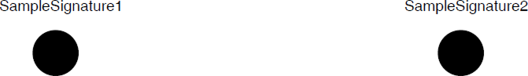

# Multiple Digital Signatures

|Minimum Version|Q2 2025|
|----|----|

Use `PdfStreamSigner` in RadPdfProcessing to add [digital signatures]() through incremental PDF revisions. It also embeds long-term validation evidence and renews document timestamps without rewriting earlier signed bytes.

>important When adding multiple signatures, export the document after each signature before importing it back again.

The following table lists the constructor and operations for signing and long-term evidence:

|Method|Description|
|----|----|
|`PdfStreamSigner(Stream outputStream)`|Creates a new instance of the `PdfStreamSigner` and specifies the output stream where the signed document is written.|
|`SignDocument(Stream originalStream, SignatureField signatureField, int pageIndex, TimeSpan? timeout)`|Adds a [digital signature]() to the PDF document.|
|`EmbedValidationInformation(Stream originalStream)`|Embeds certificate and revocation evidence through an incremental DSS update.|
|`RenewDocumentTimestamp(Stream originalStream, TimeStampServer timeStampServer, DigestAlgorithmType digestAlgorithm = DigestAlgorithmType.Sha256)`|Refreshes evidence and appends an RFC 3161 document timestamp.|

>note Starting with **Q1 2026**, the `PdfStreamSigner` supports the [TimeStamp server](). The `SignatureField` used for signing the document preserves all of its [SignatureSettings](#signature-settings) including the `TimeStampServer`.

To create a PAdES signature, configure `signatureField.Signature.Settings` according to the [baseline profile requirements](#pades-baseline-profiles) before `SignDocument()`.

The following example shows how to insert multiple [digital signatures]() into a PDF document using the `PdfStreamSigner`:

>important In .NET Standard, use `Telerik.Documents.Primitives.Rect` instead of `System.Windows.Rect`.

>note [PdfProcessing Multiple Digital Signatures Demo](https://demos.telerik.com/document-processing/pdfprocessing/multiple_digital_signatures)

<snippet id='libraries-pdf-features-digital-signature-pdfstreamsigner'/>



## Long-Term Evidence Operations

The following requirements apply to `EmbedValidationInformation()` and `RenewDocumentTimestamp()`:

* Use readable, seekable input and a distinct writable output stream.
* Keep seekable output streams empty and positioned at zero.
* Use unencrypted PDFs.

Renewal also requires a seekable output stream, at least one PDF page, and an input smaller than 2 GB. The operations authenticate signatures, timestamps, and evidence. Unsupported inputs, missing evidence, policy violations, or exceeded resource limits cause failure.

### Embedding Validation Information

`EmbedValidationInformation()` adds a *Document Security Store* (DSS) update for already timestamped `ETSI.CAdES.detached` signatures. It processes all signed fields, including invisible signatures, and skips unsigned fields. It does not add missing signature timestamps or approval signatures.

The following example writes the update to a separate output PDF:

#### __Example 1: Embed Validation Information__

```csharp
using System.IO;
using Telerik.Documents.Fixed.FormatProviders.Pdf.Streaming;

using (FileStream originalStream = File.OpenRead("timestamped.pdf"))
using (FileStream outputStream = File.OpenWrite("long-term.pdf"))
{
    outputStream.SetLength(0);
    Telerik.Documents.Fixed.FormatProviders.Pdf.Streaming.PdfStreamSigner signer =
        new PdfStreamSigner(outputStream);
    signer.EmbedValidationInformation(originalStream);
}
```

Configure [evidence retrieval settings](#validation-information-settings) before the call if your certificate infrastructure needs private endpoints.

### Renewing Document Timestamps

Renewal reuses authenticated applicable evidence and fetches missing evidence. Supply a trusted `TimeStampServer`. No approval signer's private key is required.

Use your timestamp server endpoint in the following example:

#### __Example 2: Renew a Document Timestamp__

```csharp
using System;
using System.IO;
using Telerik.Documents.Fixed.FormatProviders.Pdf.Streaming;
using Telerik.Documents.Fixed.Model.DigitalSignatures;

using (FileStream originalStream = File.OpenRead("pades-lta.pdf"))
using (FileStream outputStream = File.OpenWrite("renewed.pdf"))
{
    outputStream.SetLength(0);
    PdfStreamSigner signer = new PdfStreamSigner(outputStream);
    Telerik.Documents.Fixed.Model.DigitalSignatures.TimeStampServer timeStampServer =
        new TimeStampServer("https://tsa.example.com", TimeSpan.FromSeconds(10));

    signer.RenewDocumentTimestamp(originalStream, timeStampServer);
}
```

Schedule renewals according to your retention and cryptographic policy. B-LTA does not guarantee indefinite validity.

## Validation Information Settings

Configure `Signature.Settings.ValidationInformationSettings` for B-LT/B-LTA signatures and `PdfStreamSigner.ValidationInformationSettings` for the standalone operations. Both return a `ValidationInformationSettings` object.

### Resource Limits

The following table lists the settings and their defaults:

| Property | Default | Description |
|---|---|---|
| `AllowedHosts` | Empty list | Exact hostnames or IP addresses allowed to use private network addresses. |
| `RequestTimeout` | 15 seconds | Maximum duration of one evidence request. |
| `OperationTimeout` | 2 minutes | Maximum duration of the complete evidence retrieval operation. |
| `MaximumRequests` | 32 | Maximum number of evidence requests. |
| `MaximumTotalEvidenceBytes` | 64 MiB | Maximum combined size of downloaded certificates and revocation evidence. |

Defaults are also upper limits. Use positive values no greater than the defaults.

### Network Policy

Only B-LT/B-LTA signatures and standalone evidence operations collect long-term evidence. Ordinary signing and PDF import do not.

Requests use public endpoints unless their exact hostname or IP address appears in `AllowedHosts`. Entries cannot be URLs, wildcards, or hostname-and-port pairs. Requests do not follow redirects or use automatic credentials, cookies, or proxies.

>important HTTPS evidence retrieval requires the .NET 8 or later target assembly. The .NET Standard 2.0 and .NET Framework 4.6.2 assemblies reject HTTPS endpoints even on later runtimes.

HTTP endpoints remain supported, without HTTPS-to-HTTP downgrade. These settings do not control [timestamp server requests]().

## See Also

* [Baseline Profiles and Evidence Configuration](#pades-baseline-profiles)
* [Document Timestamp and Signature Checks]()
* [Incremental Signing of Existing Fields]()
* [Digital Signature Feature Overview]()
* [Signature Field]()
* [Multiple Digital Signatures Demo](https://demos.telerik.com/document-processing/pdfprocessing/multiple_digital_signatures)
* [Using a TimeStamp Server]()
